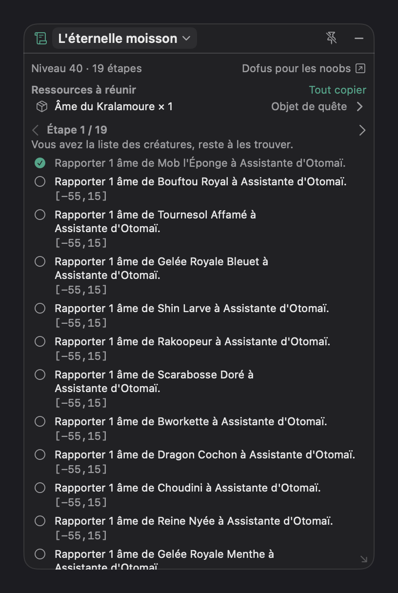
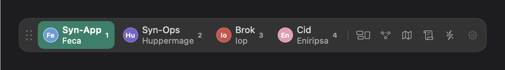
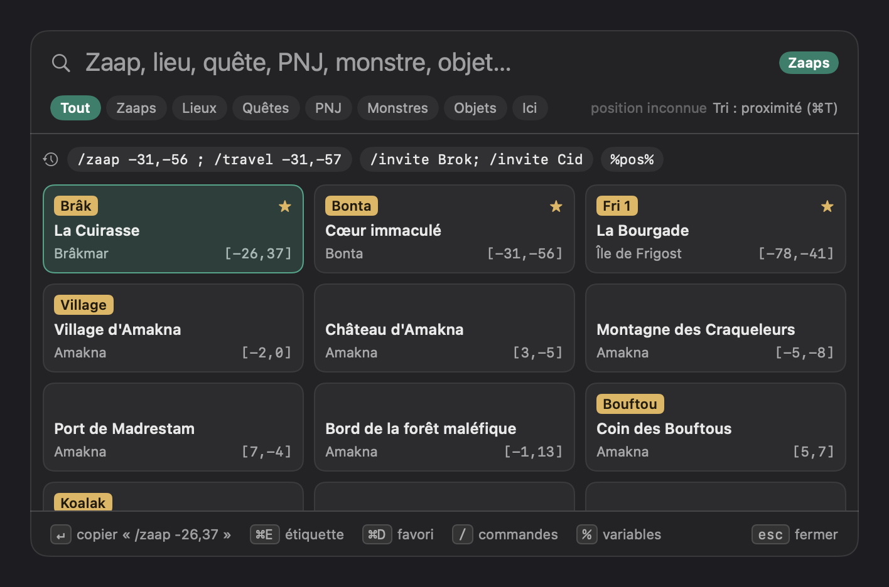
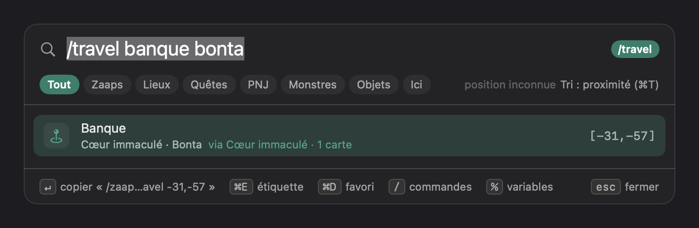
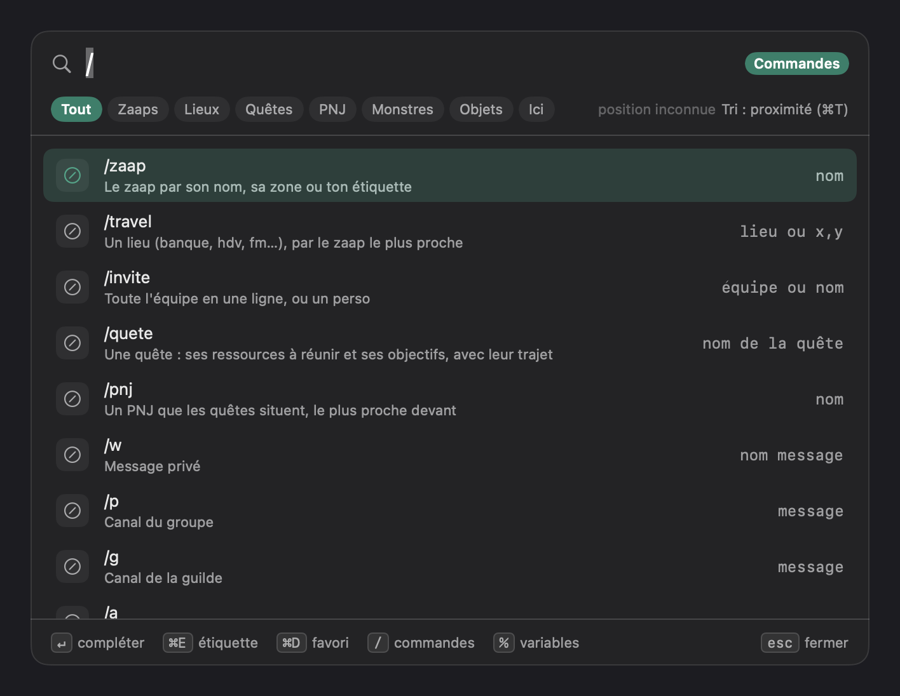
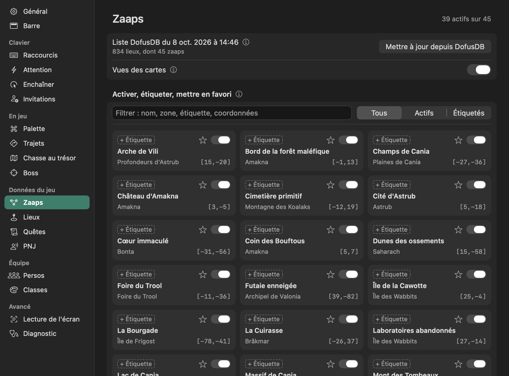

# Journal des versions

Une section par version, `## X.Y.Z — AAAA-MM-JJ` : la release GitHub de `vX.Y.Z` en reprend le
contenu (`Tools/notes-de-version.sh`), et `sh build.sh --publish` refuse une version absente d'ici.

## 0.13.0 — 2026-11-10

### Nouveautés

- **Fiche d'un donjon** dans la palette, la même qu'on cherche le donjon ou l'un de ses boss :
  niveau conseillé, trajet jusqu'à l'entrée, guide Dofus pour les noobs, clef (et où la trouver),
  boss et monstres avec niveau, PV, PA, PM et résistances, succès.
- **Combat des persos derrière** (Réglages → Lecture de l'écran, sous « Lire le combat ») : leur
  pastille montre le décompte de leur tour même quand tu ne les regardes pas, Dofus en
  arrière-plan compris. En fenêtré seulement.
- **Almanax en deux temps** : « Nom » copie l'offrande pour l'hôtel de vente, « Sanctuaire » le
  trajet pour la rendre.

### Améliorations

- Une pastille en combat, sans que ce soit son tour, prend un cadre rose discret.
- **Palette** : rouverte, elle reprend où on l'a laissée — recherche toute sélectionnée (une
  lettre la remplace), filtre, ligne et fiche dépliée. Le perso d'où partent les trajets passe à
  côté du champ, lisible en entier.
- **Fiche d'un donjon au clavier** : ↵ la déplie, le clavier sur « Entrée » (↵ encore : trajet
  copié) ; ←/→ passe d'une carte à l'autre (guide, clef, conseils, monstres, succès), ↑ revient à
  la ligne, ↵ y replie. Les **conseils tactiques** de Dofus pour les noobs se déplient dans la
  fiche, et chaque boss ou monstre dit les éléments à frapper et à éviter d'après ses résistances.

### Corrections

- Les zaaps d'une autre carte du monde (Incarnam, la Canopée, Harebourg, Crocuzko) reviennent
  décochés par défaut : le jeu refuse leur `/zaap` (la Canopée du Kimbo copiait un trajet mort).

## 0.12.0 — 2026-11-10

### Nouveautés

- **Mise à jour depuis Synfus** : chaque jour, Synfus regarde s'il existe une nouvelle version sur
  GitHub et la propose dans son menu et dans Réglages → Général. Un clic : téléchargement, contrôle,
  remplacement et relance, sans commande `xattr` à taper. Les autorisations Accessibilité et
  Enregistrement de l'écran sont à redonner à chaque version (l'app n'est pas signée par un
  certificat Apple payant) : Synfus le dit, et dit pourquoi. Désactivable (Réglages → Général).
  Cette version-ci s'installe encore à la main ; les suivantes, d'elles-mêmes.
- **Commandes entre `/zaap` et `/travel`** (Réglages → Trajets, `/a` par défaut) : le jeu ignorait
  parfois le `/travel` lancé avant que la carte du zaap ait chargé. `/zaap -1,24 ; /a ; /travel -4,29`
  lui laisse le temps.
- **Aide aux boss** : un panneau posé sur le jeu pour le Comte Harebourg (confusion des sorts lue
  à la vie et au canal combat), Kimbo, Toxoliath, Ilyzaelle et Tal Kasha, avec le tour du combat
  compté. Entrer dans la salle d'un boss le choisit ; sa fiche DofusDB (niveau, PV, PA, PM,
  résistances) et un lien vers le guide du donjon sur Dofus pour les noobs. Un bouton dans la
  barre.
- **Quêtes** :
  - le suivi du jeu relu tant que le panneau est montré, **perso par perso** : objectifs faits
    cochés, objectif en cours surligné, « Tu y es — fait ? » sur la carte de l'objectif ;
  - **où trouver** le monstre ou l'objet d'un objectif ;
  - **quêtes d'ici** : celles qui commencent et les PNJ sur la case du perso ;
  - les objectifs ouverts ensemble numérotés dans l'ordre le plus court ;
  - un panneau compact.
- **Palette** : l'almanax du jour en tête, sections Monstres et Objets (Entrée déplie où les
  trouver), PNJ en favori, une ligne de trajet dit le zaap retenu (« via Coin des Bouftous · 6
  cartes »).
- **Zones de lecture retrouvées seules** sur une capture du jeu.

### Améliorations

- Données du jeu (carte, quêtes, classes) revues chaque jour, plus seulement au lancement.
- Réglages sans phrase à l'écran : le détail passe au ⓘ, un clic mène à l'onglet cité, un
  raccourci refusé par macOS se signale.
- Palette à trois colonnes, Échap efface avant de fermer, filtres au clic.
- VoiceOver et « Réduire les animations » respectés.
- Barre et menu rangés dans le même ordre : quêtes, boss, chasse, puis rangement des fenêtres ; la
  palette au menu.
- Lecture de l'écran plus légère : une capture entière découpée dès deux zones, combat lu toutes
  les 3 s hors combat.

### Corrections

- ⌘C, ⌘V, ⌘A, ⌘Z marchent dans tous les champs ; « Fermer tous » ne se valide plus avec Entrée.
- Un PNJ ou un objectif hors du Monde des Douze se rejoint par son `/travel` seul.
- **Zaaps** : le zaap que le jeu rattache à la zone visée n'est plus remplacé par un zaap plus
  proche derrière des falaises (Mériana : Koalak, plus la Montagne des Craqueleurs) ; un PNJ, un
  lieu ou un objectif est situé par sa sous-zone, pas seulement sa case (l'Assistante d'Otomaï :
  le zaap de la Canopée, plus celui de la plage). Les zaaps de la Canopée, de Harebourg et de
  Crocuzko sont actifs par défaut.
- Un client revenu à l'écran de connexion oublie son perso.

## 0.11.0 — 2026-10-08

### Nouveautés

- **Panneaux seulement devant Dofus** (Réglages → Barre, allumé) : les panneaux des quêtes et de la
  chasse se cachent quand une autre app passe devant, et reviennent avec le jeu sans lui prendre
  le clavier.
- **Un README vitrine** : chaque fonction de Synfus en une capture, à partager d'un lien.

### Améliorations

- Les cases de zaap de la palette ont, elles aussi, la vue de leur carte en fond.
- Quêtes et chasse au même dessin : même en-tête, même bouton « − » pour cacher le panneau.

## 0.10.1 — 2026-10-08

### Nouveautés

- **Le zaap qui mène vraiment quelque part** : un `/travel` passe par le zaap que le jeu rattache à
  la zone visée — `/travel -20,9` part du zaap des Koalaks, plus de celui de Sidimote derrière la
  montagne. Éteint (Trajets → « Zaap désigné par le jeu »), le plus proche par les zones voisines.
- **Panneau des quêtes** :
  - un bouton dans la barre ;
  - un en-tête d'une ligne, avec un menu des quêtes épinglées et du **suivi lu à l'écran** ;
  - la consigne de chaque étape, les récompenses, la vue de la carte de chaque objectif, en grand
    au survol ;
  - une coche verte sur l'objectif dont on a copié le trajet ;
  - ce que la quête exige (classe, niveau, métier, alignement) ;
  - les quêtes qui suivent ;
  - un lien vers Dofus pour les noobs.

  Il ne se montre que devant Dofus.
- **Lire le suivi de quêtes** : les quêtes suivies en jeu sont reconnues et s'épinglent d'un clic, à
  leur étape.
- **Calibrer chaque lecture de l'écran** sur sa propre capture (position, combat, chasse, suivi de
  quêtes), avec un essai de lecture en direct.
- **Vues des cartes** à droite des lieux, des PNJ et des zaaps, dans la palette et les réglages,
  et en fond des cartes de zaap ; le pictogramme du jeu pour chaque lieu. Un seul interrupteur les
  masque toutes.
- **Classes tirées de DofusDB** : noms et emblèmes téléchargés par l'app ; ton icône garde la
  priorité.
- **Masquer les objets de quête** dans les ressources à réunir.

### Améliorations

- Toute position s'affiche **`[x,y]`**, comme le jeu l'écrit.
- Les onglets Zaaps, Lieux, Quêtes et PNJ des réglages s'ouvrent sans attendre.
- Raccourcis : plus de « nombre d'emplacements » — un raccourci par perso connecté, et ⌘6 reste aux
  autres apps tant qu'il n'y a pas de sixième perso.
- Chasse au trésor : une seule colonne étroite, l'indice sous la boussole.
- Pluriels justes : « 1 étape », « 1 carte ».

### Corrections

- Panneau des quêtes : la première ligne répond au clic, un double-clic ne l'agrandit plus en
  plein écran, et la croix se clique sans viser.

## 0.10.0 — 2026-10-08

### Nouveautés

- **La palette (⌘:)** : un champ de recherche au-dessus du jeu, qui prend le clavier sans passer
  devant Dofus. Tu tapes, Entrée copie, ⌘V colle dans le tchat — Synfus n'envoie toujours rien.
  Rien de tapé : les zaaps en cartes, favoris d'abord puis du plus proche, et tes dernières copies.
- **`/zaap bonta`** : un zaap par son nom, sa **zone** (Cœur immaculé → Bonta) ou ton
  **étiquette** libre (« Fri 1 », « Bouftou »), posée d'un ⌘E ; ⌘D pour un favori.
- **`/travel banque bonta`** : les **834 lieux** du jeu — banques, hôtels de vente, ateliers,
  temples, donjons, transports — avec les surnoms des joueurs (`fm`, `hdv conso`, `bijou`…). Le
  plus proche de toi passe devant, et le trajet est copié en `/zaap x,y ; /travel a,b` quand le
  zaap fait gagner du chemin.

  

- **`/`** : les commandes du jeu (`/w`, `/g`, `/p`, `/whois`, `/away`…), une commande à argument
  se complète. **`%`** : les variables du tchat (`%pos%`, `%zone%`, `%souszone%`…).

  

- **Tout Synfus au clavier** : « ranger », « session », « équipe suivante », « chasse »… et Entrée.
- **`/invite`** : toute l'équipe en une ligne, ou un perso.
- **`/quete wogew`** : les **1 976 quêtes** du jeu, **épinglées** dans un **panneau transparent**
  (un onglet par quête, redimensionnable) qui reste au-dessus du jeu sans lui prendre le clavier —
  les **ressources à réunir** avec leur catégorie (ressource, consommable, objet de quête… ; un clic
  copie le nom pour l'hôtel de vente, ou toute la liste), « en groupe » ou « donjon » quand il le
  faut, puis l'étape en cours, parcourue aux flèches ‹ › et retenue, dont un clic copie le trajet.
  Téléchargées depuis DofusDB au lancement (quelques secondes), puis tous les 30 jours.

  

- **`/pnj nom`** : les PNJ que les quêtes situent (plus de 2 000), le plus proche devant, leur
  trajet copié ; chaque case dit sa zone et combien de quêtes l'y placent — la plus citée est
  « habituelle ».
- **Filtres et tris** : les zaaps passent toujours devant ; Tab fait défiler Tout, Zaaps, Lieux,
  Quêtes, PNJ, et ⌘T trie le reste par proximité, par ordre alphabétique ou par type.

### Améliorations

- **Réglages refaits** : une seule grille (libellé à gauche, réglage à droite), des libellés
  harmonisés, et **plus d'onglets, moins chargés**, rangés par sujet — Clavier (raccourcis,
  attention, enchaîner, invitations), En jeu (palette, trajets, chasse), **Données du jeu**
  (zaaps, lieux, quêtes, PNJ, chacun à chercher et mettre à jour), Persos, Avancé (lecture de
  l'écran, diagnostic).

  

- **Une seule carte du jeu** : zaaps et lieux viennent d'une même liste DofusDB, intégrée à
  Synfus et rafraîchie tous les 30 jours.
- Le bouton Zaap de la barre ouvre la palette.
- **Chasse au trésor** : un panneau transparent, au style des quêtes, et une **boussole** — les
  quatre directions autour de « Lire », l'indice lu à l'écran.
- **Plus rapide** : la palette prépare sa recherche en fond, les zaaps et les quêtes sont indexés
  une fois.

### Changé

- **⌘: ouvre la palette** ; l'invitation passe à **⇧⌘:** (si tu l'avais changée, elle ne bouge
  pas). Le clic droit d'une pastille dit « Inviter Brok ».
- `/zaap x,y ; /travel a,b` : une espace avant le `;`, que le jeu lit mieux.

## 0.9.0 — 2026-10-07

### Nouveautés

- **Aide aux chasses au trésor** (bouton de la barre, raccourci ou menu) : départ lu à l'écran,
  direction aux flèches, indice saisi ou lu par OCR ; la carte vient de DofusDB et son `/travel`
  est copié — par un zaap si c'est plus court. La zone lue se calibre dans l'onglet Diagnostic.
- **Zaaps** : un `/travel` copié devient `/zaap x,y; /travel a,b` quand un zaap épargne assez de
  cartes — au raccourci, au bouton de la barre, ou tout seul à chaque copie.
- **Onglet Zaap** : tous les zaaps du jeu, activables un à un, ajouts à la main, liste tenue à jour
  depuis DofusDB (d'elle-même tous les 30 jours).
- **Zaaps favoris** : étoilés dans l'onglet Zaap, proposés au clic droit du bouton Zaap du plus
  proche au plus loin ; un clic copie le `/zaap`.
- **Rejoindre un perso** : clic droit sur sa pastille, son `/travel` est copié.
- **Invitations** : toutes les invitations de l'équipe d'un coup, en une ligne.

### Améliorations

- Barre plus économe : le diagnostic ne la redessine plus, la sonde d'attention est bornée.
- Compilée avec Xcode 27 et Swift 6.4.

### Retiré

- L'intégration Stream Deck.
